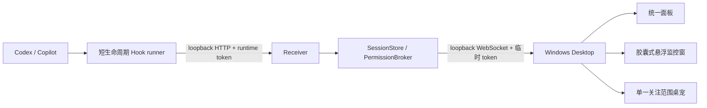

# VibeMate 当前架构

## 已实现范围

VibeMate 现在采用“设备 → 环境 → Receiver → 会话”的模型：

```text
Windows 设备
├─ Windows 本机环境 ─ Receiver ─ 多个 Codex/Copilot 会话
├─ WSL Ubuntu 环境 ─ Receiver ─ 多个 Codex/Copilot 会话
└─ WSL Debian 环境 ─ Receiver ─ 多个 Codex/Copilot 会话

树莓派/独立 Linux 设备
└─ Linux 环境 ─ Receiver ─ 多个 Codex/Copilot 会话
```

- 一个 OS 环境、一个用户只运行一个 Receiver。
- 一个 Receiver 同时接收该环境中任意数量的终端和 Agent 会话。
- 桌面端按 `environmentId` 维护多条独立连接并聚合快照。
- 全局会话身份为 `deviceId + environmentId + agent + sessionId`。
- 权限路由在此基础上增加 `requestId`；Agent Hook Protocol v1 本身保持不变。
- 配置文件只保存设备、环境和显示偏好，不保存 WebSocket 地址或 Token。

## 进程与通信



Receiver 的 Agent 接收端始终监听 `127.0.0.1`。桌面控制流也使用 Receiver 启动时
生成的动态端口和临时高熵 Token：WSL 使用 Windows 的 localhost 转发；独立 Linux
使用系统 OpenSSH 隧道。普通用户不需要输入 IP、端口、Token 或 WebSocket URL。

## 环境发现与接入

### Windows 本机

首次配置默认只创建一条未启用的本机环境。用户点击启用后，VibeMate 增量安装
Codex/Copilot Hook，并启动内嵌 Receiver。打包版 Hook 使用 Electron 自带的 Node
模式，不要求用户安装 Node.js。

### WSL

- `wsl.exe --list --verbose` 只读扫描发行版。
- 扫描不会安装 Hook，也不会启动处于 Stopped 状态的发行版。
- 用户点击启用后才识别 Linux 架构、复制随安装包携带的运行时、安装 Hook并启动
  managed Receiver。
- 后续启动只恢复用户已启用且当时已经 Running 的 WSL，不唤醒停止的 WSL。

### SSH Linux / 树莓派

- 只读解析 `~/.ssh/config` 的具体 Host 别名，也允许用户在 GUI 填写别名或 IP。
- 所有连接均调用系统 `ssh`，使用现有 OpenSSH config、key 和 agent；VibeMate 不保存
  SSH 密码或私钥。
- 只有用户点击“开始监控”后才运行 `ssh -G`、识别架构、部署运行时并连接。
- 第一条长连接控制远端 Receiver 生命周期，第二条 SSH 连接提供本地端口隧道。
- SSH 环境不会随 VibeMate 启动而自动连接。

## Receiver managed 生命周期

managed Receiver 通过 stdout 输出一次 JSON ready 消息，其中含动态控制端口和临时
Token；桌面通过 stdin 发送 `shutdown`。控制进程 stdin 意外 EOF 后，Receiver 等待
15 秒再退出，为短暂断线留出清理宽限。

退出 VibeMate 时：

1. 若仍有权限请求，只显示一次汇总确认；
2. 并行请求所有由桌面启动的 Receiver 关闭；
3. 最多等待 3 秒；单个失败只写日志，不阻塞退出；
4. Receiver 关闭会使未决定请求回到 Agent 原生审批流程。

Receiver 不是开机服务，也不支持无人值守监控。

### 客户端离线与权限回退

启用桌面 WebSocket 控制流的 Receiver 每 3 秒发送一次协议 ping，Windows 客户端
通过同一连接自动回复 pong。连续 9 秒未收到回复时，Receiver 终止该连接；明确关闭
连接时则立即处理。最后一个可用桌面连接消失后，所有待审批请求返回“无决定”，新
请求也直接回退 Agent 原生审批。事件采集仍可继续，不依赖 Receiver 进程是否退出。
重新连接可以处理新请求，但不能恢复已回退的旧审批。计时依赖 Receiver 事件循环正常
运行；Receiver 卡死时仍由 Hook 自身超时兜底，目前权限 Hook 的默认上限为 9 分钟。
默认关闭 Codex 桌面审批；用户按环境开启后，客户端通过已认证的 WebSocket 同步设置，
重连时重新同步。关闭设置立即释放待审批请求。仅在线但未开启审批的连接不算可用审批端。
独立 HTTP 开发观察器也默认关闭审批，可通过 `VIBEMATE_CODEX_APPROVALS=1` 显式启用。

Copilot 不使用阻塞式权限 Hook。安装器迁移时只移除自身旧 `permissionRequest` 条目，
增加匹配 `permission_prompt` 的 `notification` Hook。Hook runner 与 Receiver 也对旧
Copilot 权限调用直接返回无决定。通知只更新会话的等待权限状态，不创建审批请求；
界面提示用户在原终端处理。它不会修改 Copilot 的原生 Allow All 或会话授权规则。

## 展示层

- 设置页只管理环境、连接状态、启停、SSH 添加和桌宠关注范围，不再承担任务列表；首次引导完成后不自动弹出。
- 悬浮监控窗是日常常驻界面：默认是一枚胶囊，只显示进行中／待处理／刚完成的数量；点击展开为最多 5 条的精简任务列表，行内可审批 Codex；鼠标移开 3 秒自动收回。
- 出现待处理项时胶囊变琥珀色并呼吸，不会自动展开；无任务持续 30 秒后缩成小圆点。
- 监控窗拖到屏幕左右边缘会吸附并只露出一小条，悬停滑出；位置与吸附状态持久化。
- 桌宠只表现关注范围内优先级最高的任务；范围可选全部、设备、环境或会话。
- 范围外的权限请求和失败以桌宠角标显示，不抢占当前动画。
- 桌宠和监控窗可以分别从托盘隐藏。

## 构建与交付

`npm run dist:windows` 会先编译代码、生成 Linux 单文件工具、打包 Node 22 的 Linux
x64/arm64 运行时，再使用 electron-builder 生成 unsigned NSIS x64/arm64 安装包。
Linux payload 只部署到用户明确启用的环境的 `~/.vibemate`。

## 安全与明确不做

- Agent Hook 输入经过大小、结构和敏感字段约束。
- runtime 文件和环境配置使用用户私有权限；传输 Token 不持久化到桌面配置。
- 权限决定必须匹配环境、Agent、会话和请求，断线时不能提交。
- 第一版不做 LAN-only 配对、公网连接、云同步、历史数据库、自动权限策略、系统级
  Receiver 服务或无人值守监控。
