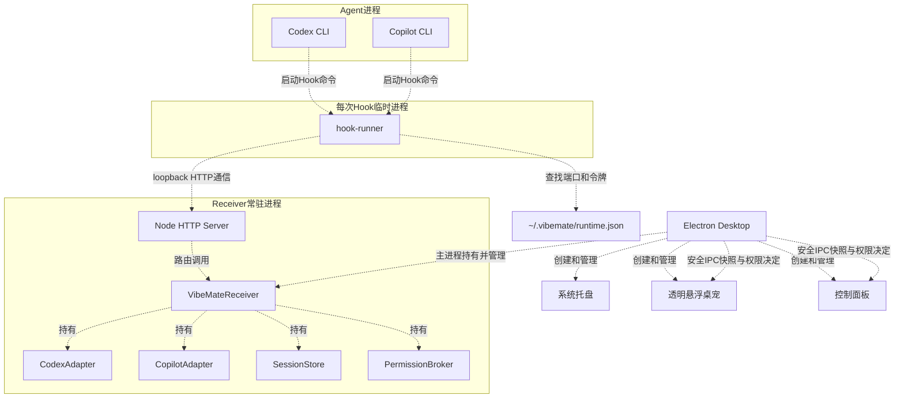
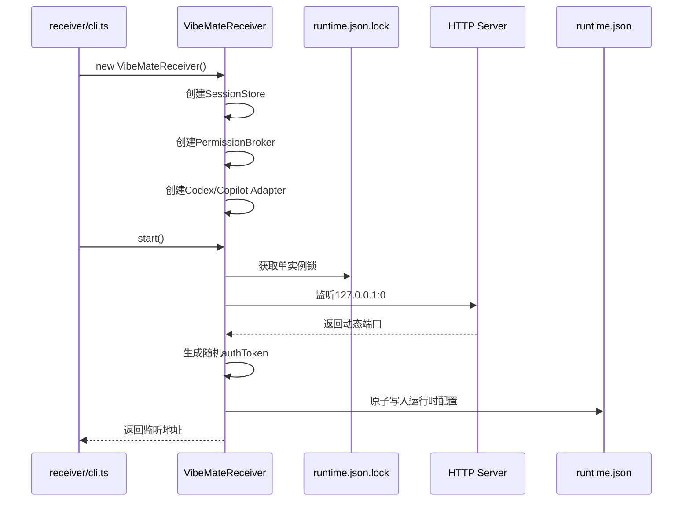
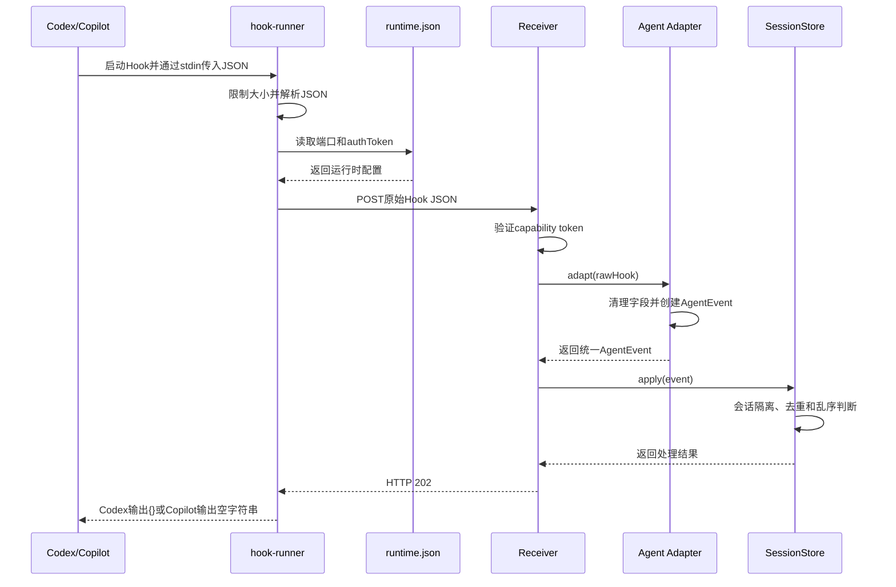
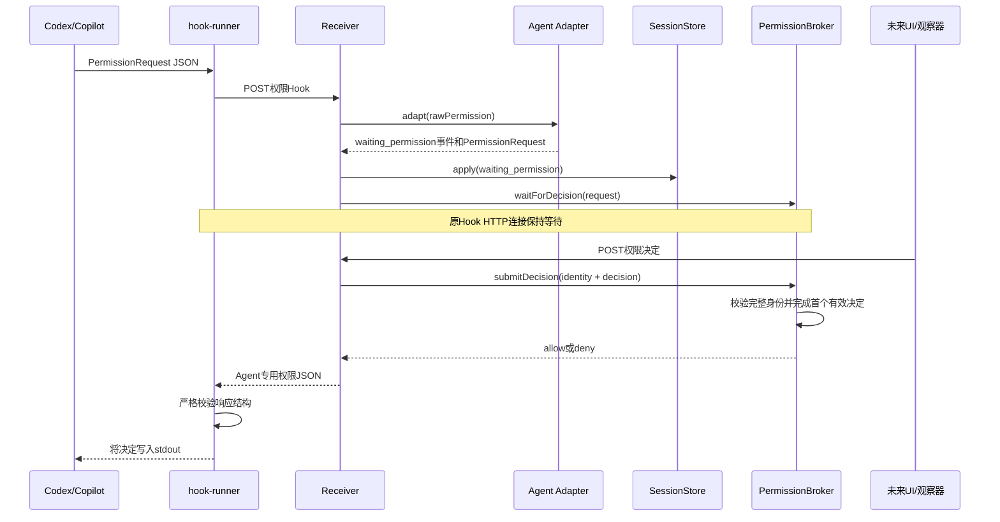
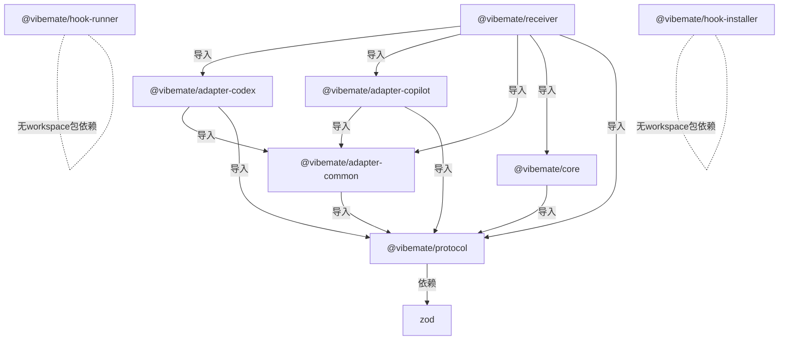

# VibeMate 当前架构

## 1. 文档范围

本文描述 VibeMate 当前已经实现的本机 Agent 接入核心，包括：

- Codex CLI 和 GitHub Copilot CLI Hook 接入
- Hook runner
- loopback HTTP Receiver
- Agent Adapter
- Protocol v1
- 多会话状态存储
- 权限请求 Broker
- Hook 增量安装与卸载

当前已实现 Electron 控制面板、托盘生命周期、透明悬浮桌宠、状态动画编排和位置
记忆。桌宠支持空闲、思考、工作、等待权限、完成、失败和会话结束动画，以及工作
和休息状态的进入/循环/退出过渡。尚未实现安装打包、远程中继和会话持久化。

> 图表约定：运行流程图只表示请求实际按时间顺序经过的步骤；模块依赖、对象持有、
> 文件查找和通信关系使用单独的结构图或依赖图表达。

## 2. 架构概览

当前系统采用本地优先的分层架构：

```text
Agent Hook
  → Hook runner
  → loopback HTTP Receiver
  → Agent Adapter
  → Protocol v1
  → SessionStore / PermissionBroker
```

其中：

- Receiver 是常驻进程，持有核心运行时状态。
- Hook runner 是每次 Hook 触发时创建的短进程。
- Hook installer 是显式执行的一次性配置工具，不参与日常事件处理。
- SessionStore 和 PermissionBroker 当前只保存在内存中。

## 3. 静态运行时结构

下图表达进程、运行时对象、文件和通信关系，不表示执行时间顺序。



### 3.1 进程类型

#### Receiver 常驻进程

- 由 `packages/receiver/src/cli.ts` 启动。
- 监听 `127.0.0.1` 动态端口。
- 保存会话状态和等待中的权限请求。
- 创建并持有所有核心运行时对象。
- 收到 `SIGINT` 或 `SIGTERM` 时关闭权限请求、HTTP 服务和运行时锁。

Receiver 内部按职责拆分：

- `index.ts` 管理服务启动、关闭、监听地址和运行时发现文件。
- `router.ts` 管理认证、HTTP 路由、Adapter 调用和协议响应。
- `http.ts` 管理限长 JSON 读取和通用 JSON 响应。
- `runtime-config.ts` 管理单实例锁及运行时发现文件的原子写入和清理。

#### Hook runner 临时进程

- 每次 Agent 触发 Hook 时启动。
- 从 stdin 读取一次原始 Hook JSON。
- 读取 Receiver 的运行时发现文件。
- 发起一次 HTTP 请求。
- 将权限结果写入 Agent stdout 后退出。
- 不保存跨 Hook 状态。
- `runtime-config.ts` 集中管理发现文件的读取、安全检查和字段校验；该实现保持零
  运行时依赖，避免增加每次 Hook 启动的依赖加载成本。

#### Hook installer 一次性进程

- 仅在用户显式运行安装或卸载命令时执行。
- 修改 Codex/Copilot Hook 配置。
- 不连接 Receiver，也不参与事件和权限处理。

## 4. 实际运行流程

本章中的图只表示真实的时间顺序。

### 4.1 Receiver 启动流程



运行时发现文件默认为：

```text
~/.vibemate/runtime.json
```

文件内容：

```json
{
  "protocolVersion": 1,
  "host": "127.0.0.1",
  "port": 12345,
  "pid": 1234,
  "startedAt": "2026-08-13T12:00:00.000Z",
  "authToken": "random-capability-token"
}
```

安全约束：

- 文件权限为 `0600`。
- 父目录以 `0700` 创建。
- Receiver 使用 `.lock` 文件实现协作式单实例保护。
- 旧实例关闭时只删除属于自身 PID 和端口的运行时文件。

### 4.2 生命周期事件流程

生命周期事件包括用户提交、工具调用、完成、失败和会话结束等事件。



生命周期事件使用 1 秒本机投递超时。Receiver 不可用、认证失败或请求超时时，
runner 会退出并使用 Agent 原生回退输出。

### 4.3 权限请求流程

权限请求会保持 Hook HTTP 连接，直到用户决定、超时或出现无决定条件。



权限请求的完整身份为：

```text
sourceProfile + agent + sessionId + requestId
```

相同 `requestId` 可以出现在不同会话中，不会造成权限串线。

以下情况会得到无决定：

- 权限请求超时
- Receiver 关闭
- Hook HTTP 连接中止
- PermissionBroker 容量耗尽
- Hook 输入不合法或过大
- Receiver 响应格式不可信
- capability token 不匹配
- Receiver 或运行时发现文件不存在

无决定时的 Agent stdout：

| Agent | 输出 |
| --- | --- |
| Codex | `{}` |
| Copilot | 空字符串 |

Agent 随后继续使用自身的原生审批流程。

## 5. 运行时对象

### 5.1 VibeMateReceiver

`VibeMateReceiver` 是当前常驻进程的组合根：

```ts
class VibeMateReceiver {
  sessions: SessionStore;
  permissions: PermissionBroker;

  codex: CodexAdapter;
  copilot: CopilotAdapter;

  server?: HTTPServer;
  address?: ReceiverAddress;
  runtimeLock?: RuntimeLock;
  authToken?: string;
}
```

职责：

- 创建并持有 Core 和 Adapter 对象。
- 管理 HTTP Server 生命周期。
- 认证请求并匹配路由。
- 把原始 Hook 交给对应 Adapter。
- 把统一事件提交给 SessionStore。
- 把权限请求提交给 PermissionBroker。
- 把权限结果转换为 Agent 所需的 HTTP 响应。

### 5.2 AdapterRuntime

每个 Agent Adapter 持有自己的 `AdapterRuntime`：

```text
CodexAdapter
  └── AdapterRuntime

CopilotAdapter
  └── AdapterRuntime
```

`AdapterRuntime` 保存：

```text
sourceProfile
permissionTimeoutMs
nowProvider
idProvider
activeTurns: Map<agent + sessionId, turnId>
```

它负责：

- 生成或规范化 `eventId`。
- 生成或规范化 `requestId`。
- 标准化事件时间。
- 跟踪每个会话当前执行轮次。
- 让同一轮次的多个完成信号共享 `turnId`。
- 计算权限请求过期时间。

该状态仅存在于内存中，Receiver 重启后当前 turn 跟踪会丢失。

### 5.3 SessionStore

主要内部结构：

```text
sessions:
  Map<sessionKey, SessionRecord>

seenEventIds:
  Set<sessionKey + eventId>

seenEventOrder:
  string[]
```

每个 `SessionRecord` 保存：

```text
会话身份
当前统一状态
最后状态发生时间
最近事件
已完成turn集合
已完成turn顺序
```

默认边界：

- 每个会话最多保存最近 50 个事件。
- 全局最多记住 10000 个会话内事件去重键。
- 每个会话最多记住 256 个已完成 turn。

处理规则：

- 会话由 `sourceProfile + agent + sessionId` 隔离。
- 相同会话中的相同 `eventId` 只处理一次。
- 迟到事件可以进入最近事件历史，但不能覆盖更新状态。
- 同一个 `turnId` 最多产生一次 `completed`。

当前 SessionStore 是纯内存存储，Receiver 退出后会话快照不会保留。

### 5.4 PermissionBroker

主要内部结构：

```text
pending:
  Map<sessionKey + requestId, PendingPermission>

finalized:
  Set<sessionKey + requestId>
```

`PendingPermission` 持有：

- 受限并经过校验的 `PermissionRequest`
- Promise 的 `resolve`
- 权限过期定时器
- HTTP 中止信号
- HTTP 中止处理函数

默认边界：

- 最多 256 个同时等待的权限请求。
- 最多记住最近 1000 个已完成权限身份。

处理规则：

```text
第一个身份完整匹配的有效最终决定生效
```

后续或无效提交会返回：

```text
already_finalized
not_found
identity_mismatch
expired
```

### 5.5 Hook runner

Hook runner 不保存长期运行时对象。每次执行只创建当前请求所需的数据：

```text
原始stdin字符串
解析后的原始Hook对象
RuntimeConfig
HTTP Response
HookRunResult
```

职责：

- 限制 stdin 最大为 256 KiB。
- 验证运行时文件大小、权限和所有者。
- 验证目标只能是 `127.0.0.1`。
- 携带 capability token。
- 生命周期请求最多等待 1 秒。
- 权限请求最多等待 9 分钟。
- Receiver 响应最大为 16 KiB。
- 权限 JSON 只有符合允许字段的结构才会写入 Agent stdout。

## 6. Protocol v1

### 6.1 统一事件

统一事件的主要结构：

```ts
interface AgentEvent {
  protocolVersion: 1;
  eventId: string;
  sourceProfile: string;
  agent: "codex" | "copilot";
  sessionId: string;
  state: UnifiedState;
  event: string;
  occurredAt: string;
  turnId?: string;
  cwd?: string;
  tool?: ToolMetadata;
  process?: ProcessMetadata;
}
```

### 6.2 统一状态

```text
idle
thinking
working
waiting_permission
completed
failed
ended
```

### 6.3 会话键

会话键使用版本化、分段编码格式：

```text
v1.<sourceProfile-base64url>.<agent>.<sessionId-base64url>
```

它避免简单字符串拼接带来的分隔符冲突，并为未来协议版本预留升级空间。

### 6.4 数据边界

- 生命周期事件最大 16 KiB。
- 权限请求最大 32 KiB。
- 原始 Hook HTTP 输入最大 256 KiB。
- Schema 严格拒绝未知字段。
- 不保存完整提示词、命令、diff、文件内容或工具输出。
- 工具输入只生成 SHA-256 指纹。
- 工具摘要只读取受限、清理后的 `description`。

## 7. 代码模块

| 模块 | 职责 |
| --- | --- |
| `protocol` | 统一协议、Schema、状态、大小限制、清理和会话键 |
| `core` | 多会话状态存储、事件去重和权限 Broker |
| `adapter-common` | Adapter 公共清理、指纹、ID 和 turn 跟踪 |
| `adapter-codex` | Codex Hook 到 Protocol v1 的映射 |
| `adapter-copilot` | Copilot Hook 到 Protocol v1 的映射 |
| `receiver` | HTTP 服务、路由、认证和运行时发现 |
| `hook-runner` | Hook stdin 投递、权限 stdout 和原生回退 |
| `hook-installer` | 增量安装、冲突检测、备份和卸载 |

## 8. 静态代码依赖关系

下图只表示 npm/import 依赖，不表示请求运行顺序。



依赖方向遵循：

```text
协议层
  ↑
核心层和公共适配层
  ↑
Agent适配层
  ↑
Receiver组合层
```

`protocol` 和 `core` 不知道 HTTP、Codex、Copilot、Electron 或桌宠的存在。

`hook-runner` 和 `hook-installer` 刻意保持零 workspace 包依赖，避免核心包加载失败
影响 Agent Hook 的原生回退。

## 9. HTTP API

| Method | Path | Purpose |
| --- | --- | --- |
| `GET` | `/health` | 服务和协议版本检查 |
| `GET` | `/v1/snapshot` | 当前会话和待处理权限快照 |
| `POST` | `/v1/hooks/codex` | 接收 Codex 原始 Hook |
| `POST` | `/v1/hooks/copilot/:event` | 接收 Copilot 原始 Hook |
| `POST` | `/v1/permissions/:requestId/decision` | 提交完整身份绑定的权限决定 |

所有 API 都要求：

```http
X-VibeMate-Token: <runtime authToken>
```

当前没有 SSE 或 WebSocket。未来 UI 可以通过快照和权限决定 API 接入，实时推送方式
仍未实现。

## 10. Hook 安装与卸载

安装：

```bash
npm run hooks:install
npm run hooks:install -- codex
npm run hooks:install -- copilot
```

卸载：

```bash
npm run hooks:uninstall
npm run hooks:uninstall -- codex
npm run hooks:uninstall -- copilot
```

Codex 配置位置：

```text
$CODEX_HOME/hooks.json
或 ~/.codex/hooks.json
```

Copilot 配置位置：

```text
$COPILOT_HOME/hooks/vibemate.json
或 ~/.copilot/hooks/vibemate.json
```

安装器规则：

- 只更新带 `vibemate-hook-runner` 标记的条目。
- 保留用户已有字段和 Hook。
- 重复安装不会重复添加。
- 修改已有文件前创建 `.vibemate-*.bak` 备份。
- 使用同目录临时文件和原子替换。
- 已有配置不是有效 JSON 时停止，不覆盖原文件。
- 卸载只移除 VibeMate 自己管理的条目。
- Copilot 已存在其他 `permissionRequest` Hook 时，不安装 VibeMate 权限接管。

## 11. 代码组织方式

仓库技术栈：

```text
Node.js 22
TypeScript strict mode
npm workspaces
ES Modules
tsc build mode
node:test
```

目录：

```text
vibemate/
├── package.json
├── tsconfig.base.json
├── packages/
│   ├── protocol/
│   ├── core/
│   ├── adapter-common/
│   ├── adapter-codex/
│   ├── adapter-copilot/
│   ├── receiver/
│   ├── hook-runner/
│   └── hook-installer/
└── docs/
```

包内通常采用：

```text
package/
├── package.json
├── tsconfig.json
├── src/
│   ├── index.ts
│   ├── cli.ts
│   └── *.test.ts
└── dist/
```

根命令：

```bash
npm run build
npm test
npm run typecheck
npm run start:receiver
npm run hooks:install
npm run hooks:uninstall
```

## 12. 当前完成边界

已经完成：

- Protocol v1
- 多会话身份和状态存储
- 事件去重、乱序处理和每轮完成去重
- PermissionBroker
- Codex/Copilot Adapter
- loopback HTTP Receiver
- capability token 和运行时锁
- Hook runner
- 权限输出校验和原生回退
- Hook 增量安装、冲突检测、备份和卸载

尚未完成：

- 正式桌宠美术资源和逐帧动画
- Windows/macOS/Linux 安装打包和自启动
- 会话持久化
- SSE 或 WebSocket 实时推送
- 远程加密 WebSocket 中继
- 真实 Codex/Copilot 端到端验证

当前架构可以概括为：

> 一个本机常驻 Receiver 作为 Core 的组合根；每个 Agent Hook 通过独立短进程安全
> 投递；Adapter 负责统一协议转换；SessionStore 和 PermissionBroker 负责多会话
> 状态与权限闭环；所有异常路径优先保证 Agent 原生审批仍可使用。
